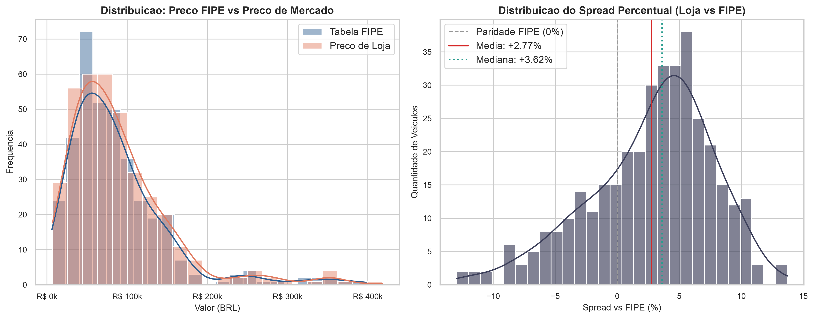
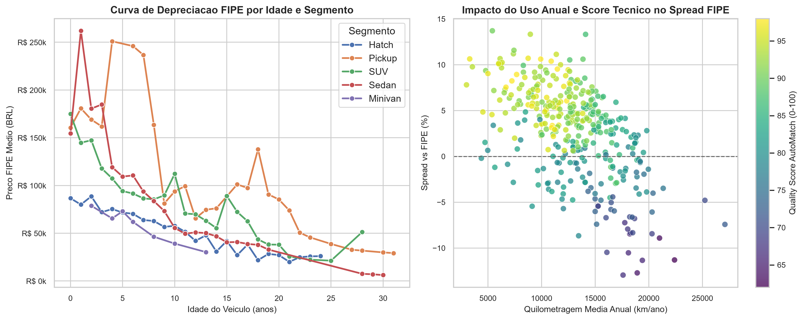
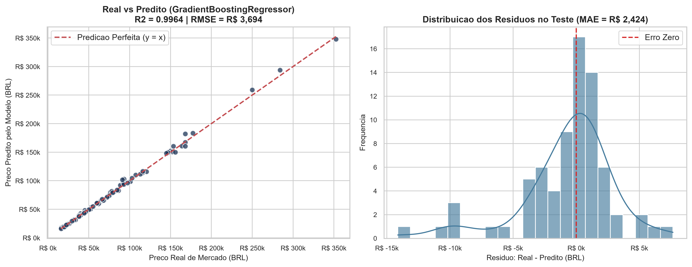
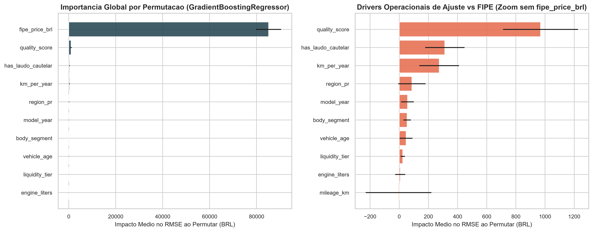

# Precificação Inteligente de Veículos Seminovos & Usados — Ingá Multimarcas (AutoMatch)

Projeto de portfólio end-to-end em **Ciência de Dados** focado no problema real de precificação automotiva e avaliação de permutas (*AutoMatch*) inspirado na operação da **Ingá Multimarcas (Maringá/PR)**. O repositório integra coleta real da **Tabela FIPE (API Parallelum v2)**, modelagem relacional e analítica em **PostgreSQL/SQLite**, análise exploratória e testes de hipótese estatística em **Python/SciPy**, pipeline preditivo em **Scikit-learn** e testes automatizados com **Pytest**.

---

## 1. Problema de Negócio

Em concessionárias multimarcas e plataformas de troca direta (*trade-in*), usar apenas o preço bruto da **Tabela FIPE** gera distorções comerciais relevantes:
- Veículos com **alta quilometragem anual** (>15.000 km/ano) ou **sem laudo cautelar** sofrem deságio real frente à FIPE.
- Seminovos bem conservados (`quality_score` elevado), com laudo aprovado e alta liquidez na praça de **Maringá/PR**, sustentam ágio positivo sobre a referência oficial.

O objetivo deste projeto é:
1. Coletar e estruturar preços oficiais reais da Tabela FIPE para 9 marcas relevantes no mercado brasileiro.
2. Modelar as regras operacionais de pontuação técnica (*Quality Score*) e precificação inspiradas no sistema **AutoMatch**.
3. Construir e validar consultas SQL analíticas (agregações, depreciação ano a ano, *window functions* e auditoria de erro).
4. Treinar e comparar modelos de regressão supervisionada para prever o preço de mercado pedido (`market_asking_price`) com validação cruzada e conjunto *holdout*.

---

## 2. Arquitetura do Projeto

```text
API Pública Tabela FIPE (v2)
        │  [src/fetch_fipe_data.py: retry, rate-limit, cache JSON]
        ▼
data/raw_fipe_vehicles.csv (367 registros reais FIPE)
        │  [Enriquecimento AutoMatch: km, praça PR, laudo, quality_score]
        ▼
data/vehicles_market_dataset.csv (367 linhas x 24 colunas)
   ├──► sql/schema_postgresql.sql + sql/analytical_queries.sql
   │       └─► [src/run_sql_validation.py] ─► 6 queries validadas em SQLite
   ├──► src/train_pricing_model.py
   │       ├─► models/vehicle_price_model.joblib (GradientBoostingRegressor)
   │       ├─► reports/model_metrics.json & data/pricing_predictions.csv
   │       └─► reports/figures/*.png (4 gráficos executivos)
   └──► notebooks/01_eda_and_price_prediction.ipynb (executado via nbconvert)
```

---

## 3. Origem dos Dados e Metodologia de Enriquecimento

- **Fonte Oficial (`data/raw_fipe_vehicles.csv`):** **367 registros reais e distintos** coletados diretamente da API pública `https://fipe.parallelum.com.br/api/v2/cars` (referência **novembro de 2026**), cobrindo **9 marcas** (`Chevrolet`, `Dodge`, `Fiat`, `Ford`, `Honda`, `Hyundai`, `Jeep`, `Toyota`, `Volkswagen`), **62 famílias de modelos**, anos-modelo de **1995 a 2027** e faixa de preço FIPE entre **R$ 6.184,00** e **R$ 397.700,00** (média **R$ 86.648,06**).
- **Enriquecimento Documentado (`data/vehicles_market_dataset.csv`):** A partir dos dados reais FIPE (`data_origin = FIPE_REAL_API_ENRICHED`, semente fixa `42`), foram simuladas variáveis operacionais inspiradas no catálogo AutoMatch: `mileage_km`, `km_per_year`, `region_pr` (`Maringá - PR`, `Curitiba - PR`, `Londrina - PR`, `Cascavel - PR`, `Outras Praças (SP/SC)`), `has_laudo_cautelar`, `quality_score` (0–100) e `market_asking_price` (média **R$ 89.043,05**, spread médio **+2,77%**).

---

## 4. Principais Descobertas Estatísticas e SQL

### Estatística Inferencial (Notebook Executado)
- **Score Técnico vs Spread FIPE:** Correlação forte positiva (`Pearson r = +0,8334`, `p = 4,94e-96`; `Spearman rho = +0,7691`, `p = 5,81e-73`).
- **Desgaste Anual (`km_per_year`) vs Spread FIPE:** Correlação negativa significativa (`Pearson r = -0,5611`, `p = 7,93e-32`).
- **Praça Regional (`Maringá - PR` vs Outras Praças):** Veículos em Maringá (`n = 152`, spread médio **+3,63%**) apresentam spread significativamente superior às demais praças (`n = 215`, média **+2,16%**; Welch `t = 2,820`, `p = 5,09e-03`; Mann-Whitney `p = 2,94e-03`).
- **Laudo Cautelar:** Anúncios com laudo (`n = 279`, spread médio **+4,62%**) superam fortemente anúncios sem laudo (`n = 88`, média **-3,09%**; Welch `t = 16,068`, `p = 4,81e-33`).

### Exemplos das Queries Analíticas SQL ([sql/analytical_queries.sql](sql/analytical_queries.sql))
Todas as 6 queries em padrão PostgreSQL ([sql/schema_postgresql.sql](sql/schema_postgresql.sql)) foram executadas e validadas sem erros em SQLite (`src/run_sql_validation.py`):
- **Regime de Quilometragem (`q5_mileage_regime_impact`):**
  - Baixa (`< 9k km/ano`, `n = 55`): score médio **91,2** | spread médio **+6,54%** (+R$ 5.150,02)
  - Moderada (`9k–15k km/ano`, `n = 207`): score médio **89,5** | spread médio **+3,78%** (+R$ 3.343,45)
  - Intensa (`> 15k km/ano`, `n = 105`): score médio **79,3** | spread médio **-1,19%** (-R$ 917,94)
- **Spread Regional x Laudo (`q3_regional_spread_maringa_vs_others`):** `Maringá - PR` com laudo (`n = 117`) atinge spread médio de **+5,25%** contra **+2,39%** em `Outras Praças (SP/SC)` com laudo (`n = 31`).

```sql
-- Exemplo (Query 4): Ranking de qualidade/custo-beneficio por marca e media movel FIPE
WITH ranked_vehicles AS (
    SELECT
        f.brand, f.model, f.model_year, m.quality_score, m.fipe_spread_pct,
        DENSE_RANK() OVER (
            PARTITION BY f.brand
            ORDER BY m.quality_score DESC, m.fipe_spread_pct ASC, f.model_year DESC
        ) AS rank_qualidade_marca,
        ROUND(AVG(f.fipe_price_brl) OVER (
            PARTITION BY f.brand ORDER BY f.model_year ASC
            ROWS BETWEEN 1 PRECEDING AND 1 FOLLOWING
        ), 2) AS media_movel_fipe_3_registros
    FROM vehicles_fipe_reference f
    INNER JOIN market_listings m ON f.vehicle_id = m.vehicle_id
)
SELECT * FROM ranked_vehicles WHERE rank_qualidade_marca <= 3;
```

---

## 5. Resultados de Machine Learning (`reports/model_metrics.json`)

Divisão estratificada por quintis de preço: **293 amostras de treino** (5-Fold CV) e **74 amostras de holdout teste**, com pré-processamento via `ColumnTransformer` (`SimpleImputer` + `StandardScaler` para 8 variáveis numéricas; `SimpleImputer` + `OneHotEncoder` para 6 categóricas).

| Modelo | CV RMSE (BRL) | CV R² | Holdout RMSE (BRL) | Holdout MAE (BRL) | Holdout R² | Holdout MAPE (%) |
| --- | ---: | ---: | ---: | ---: | ---: | ---: |
| **GradientBoostingRegressor** *(Campeão)* | R$ 6.559,44 | 0,98893 | **R$ 3.693,81** | **R$ 2.423,96** | **0,99637** | **2,725%** |
| RandomForestRegressor | R$ 8.203,50 | 0,98290 | R$ 4.925,53 | R$ 3.072,71 | 0,99355 | 3,521% |
| Ridge (`alpha=5.0`) | R$ 4.311,51 | 0,99470 | R$ 4.967,12 | R$ 2.647,43 | 0,99344 | 3,891% |
| LinearRegression | R$ 3.538,65 | 0,99657 | R$ 5.934,62 | R$ 2.556,65 | 0,99063 | 3,293% |

- **Principais drivers operacionais (Permutation Importance no Holdout, além de `fipe_price_brl` = R$ 85.112,39):**
  1. `quality_score` (+R$ 968,88 no RMSE)
  2. `has_laudo_cautelar` (+R$ 312,21)
  3. `km_per_year` (+R$ 274,04)
  4. `region_pr` (+R$ 86,66)
  5. `model_year` (+R$ 56,41)

---

## 6. Visualizações Executivas

| Distribuição de Preços e Spread | Curva de Depreciação e Uso Anual |
| :---: | :---: |
|  |  |

| Real vs Predito e Resíduos (Holdout) | Importância das Variáveis (Permutação) |
| :---: | :---: |
|  |  |

---

## 7. Como Reproduzir Localmente

```bash
# 1. Criar ambiente virtual e instalar dependencias
uv venv .venv
uv pip install --python .venv/Scripts/python.exe -r requirements.txt

# 2. Coletar dados da Tabela FIPE e gerar base enriquecida (usa cache local se disponivel)
.venv/Scripts/python.exe src/fetch_fipe_data.py

# 3. Treinar e avaliar modelos + gerar graficos em reports/figures/
.venv/Scripts/python.exe src/train_pricing_model.py

# 4. Validar schema PostgreSQL e executar as 6 queries analiticas
.venv/Scripts/python.exe src/run_sql_validation.py

# 5. Re-executar o notebook de EDA e modelagem
.venv/Scripts/jupyter.exe nbconvert --to notebook --execute --inplace notebooks/01_eda_and_price_prediction.ipynb

# 6. Rodar suite de testes automatizados (4 testes)
.venv/Scripts/pytest.exe -v
```

---

## 8. Estrutura do Repositório

- `src/fetch_fipe_data.py` — Coleta da API FIPE com cache, retry/rate-limit e enriquecimento AutoMatch.
- `src/train_pricing_model.py` — Pipeline Scikit-learn, validação cruzada, seleção de modelo e gráficos.
- `src/run_sql_validation.py` — Validação automatizada de DDL e queries SQL.
- `src/build_notebook.py` — Gerador reprodutível do notebook analítico.
- `sql/schema_postgresql.sql` & `sql/analytical_queries.sql` — Modelagem relacional e 6 consultas analíticas.
- `notebooks/01_eda_and_price_prediction.ipynb` — Notebook completo executado com gráficos e testes estatísticos.
- `models/vehicle_price_model.joblib` — Pipeline treinado pronto para inferência.
- `tests/test_pipeline.py` — Testes unitários e de integração com `pytest`.
